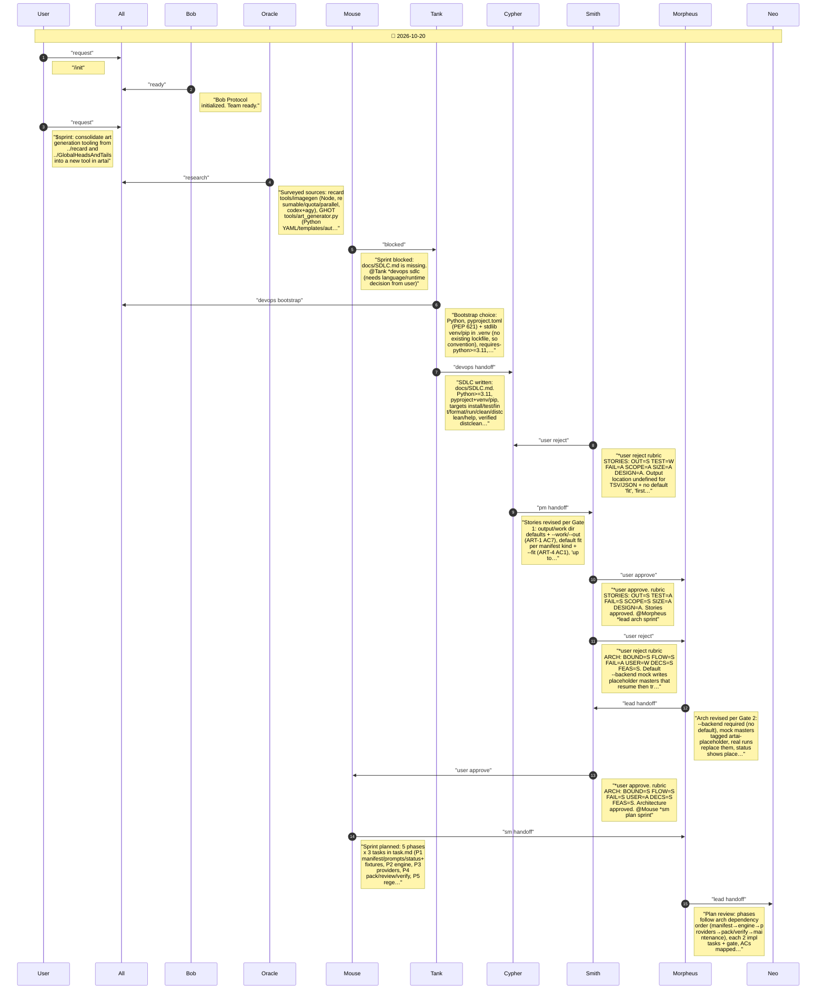
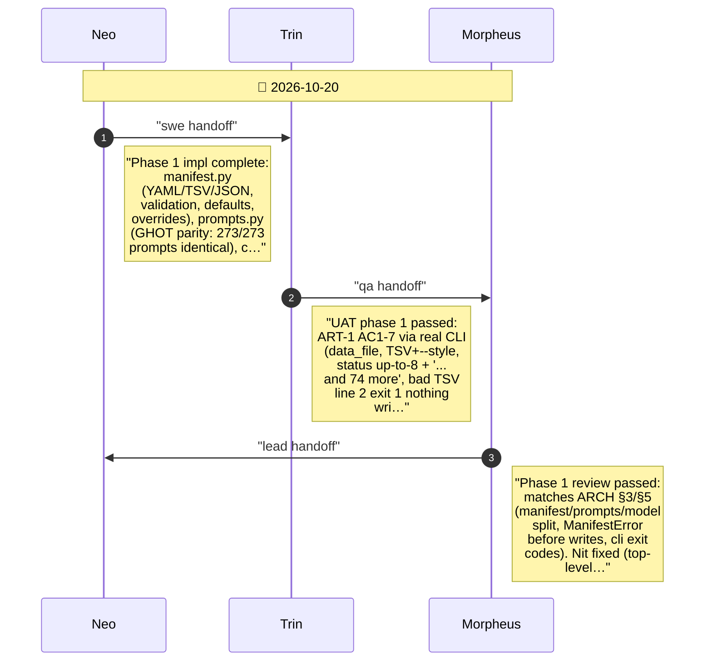
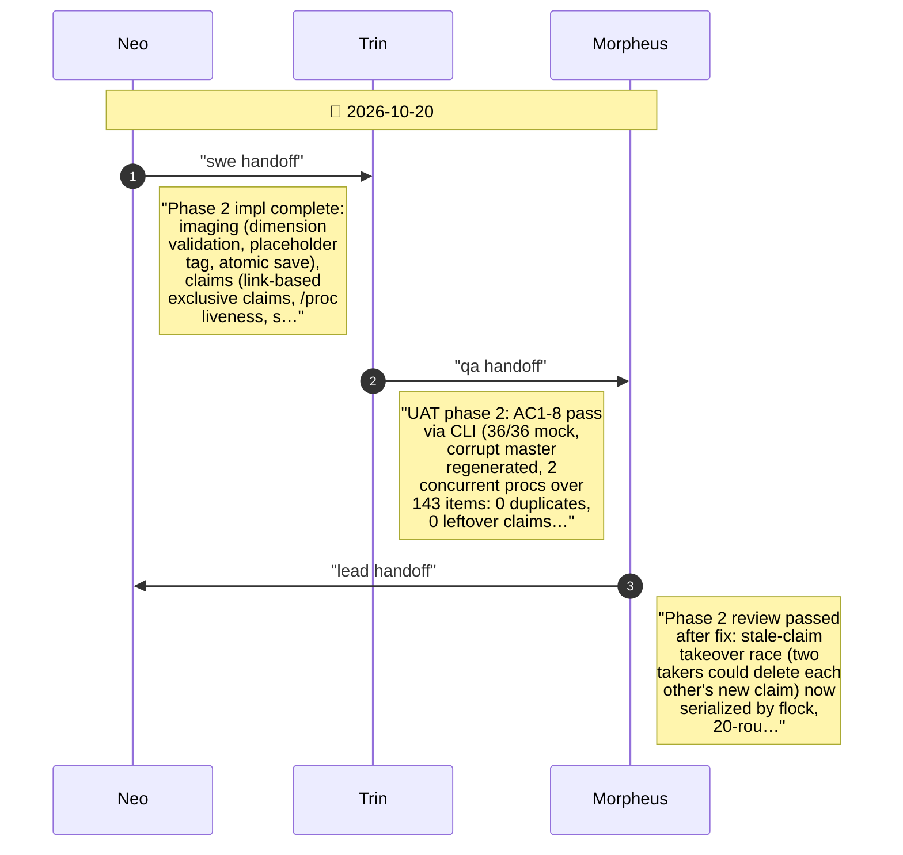
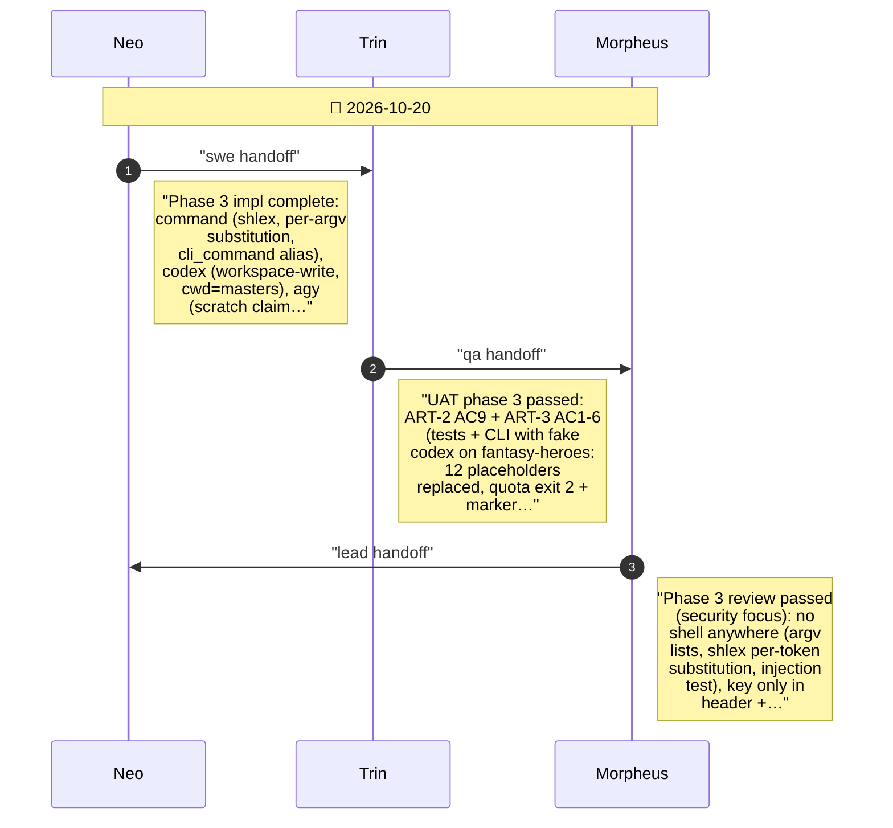
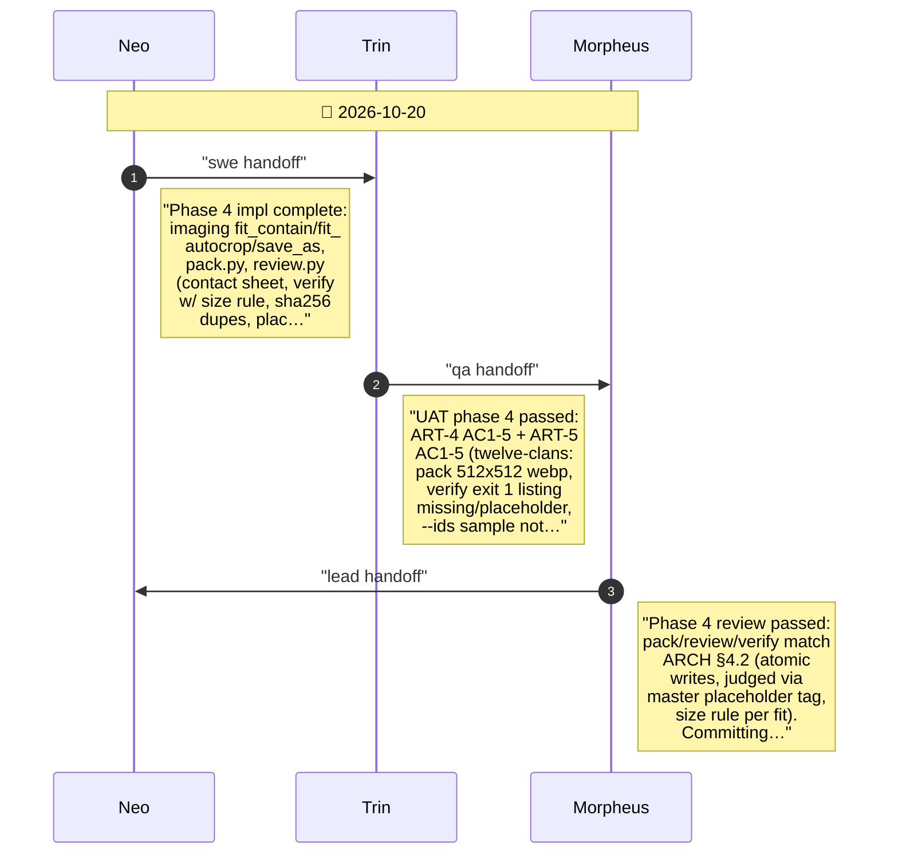
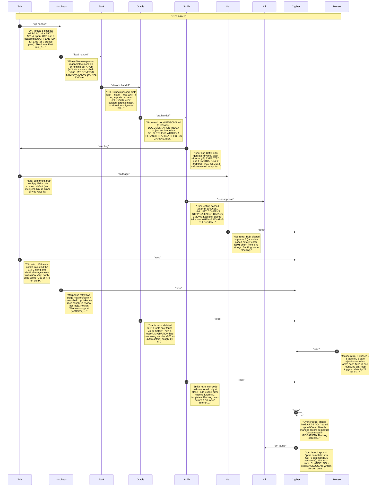

# CHAT_SPRINT_1 — Sprint Archive

## Summary

Sprint 1 built artai, one Python CLI that consolidates recard's imagegen and GlobalHeadsOrTails' art_generator (plus its deleted sticker_art/nanobanana tools). Tank wrote the SDLC; stories and arch each passed Smith on round 2 (output dirs/fit defaults; --backend required + tagged mock art). Five phases shipped manifests+prompts (273/273 GHOT parity), the resumable claim-based runner, codex/agy/gemini/command backends, pack/review/verify, regenerate/unlock and docs. UAT/review caught a Ctrl-C hang, a stale-claim race, phone overflow, ignored min_size and an exit-code collision; all fixed. 138 tests; version bump awaits owner.

---

## Planning

---

## Phase 1

Phase 1: manifests, prompts, status + parity fixtures

---

## Phase 2

Phase 2: resumable generation engine (imaging, claims, backends base+mock, runner, generate CLI)

---

## Phase 3

Phase 3: real providers (command, codex, agy, gemini)

---

## Phase 4

Phase 4: pack, review, verify

---

## Phase 5

Phase 5: regenerate/unlock, parity end-to-end, USAGE + MIGRATION docs

