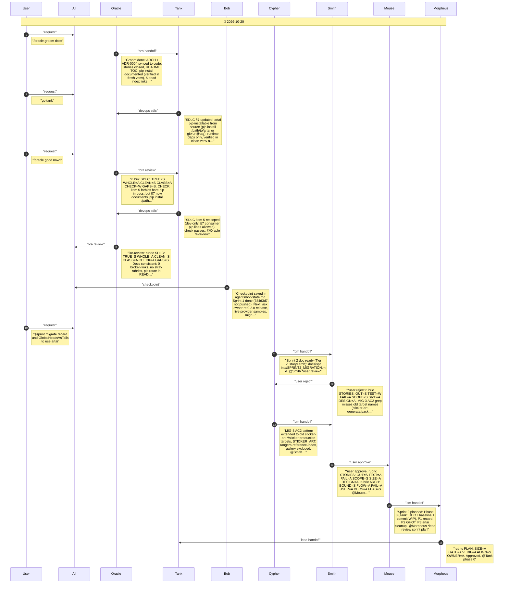
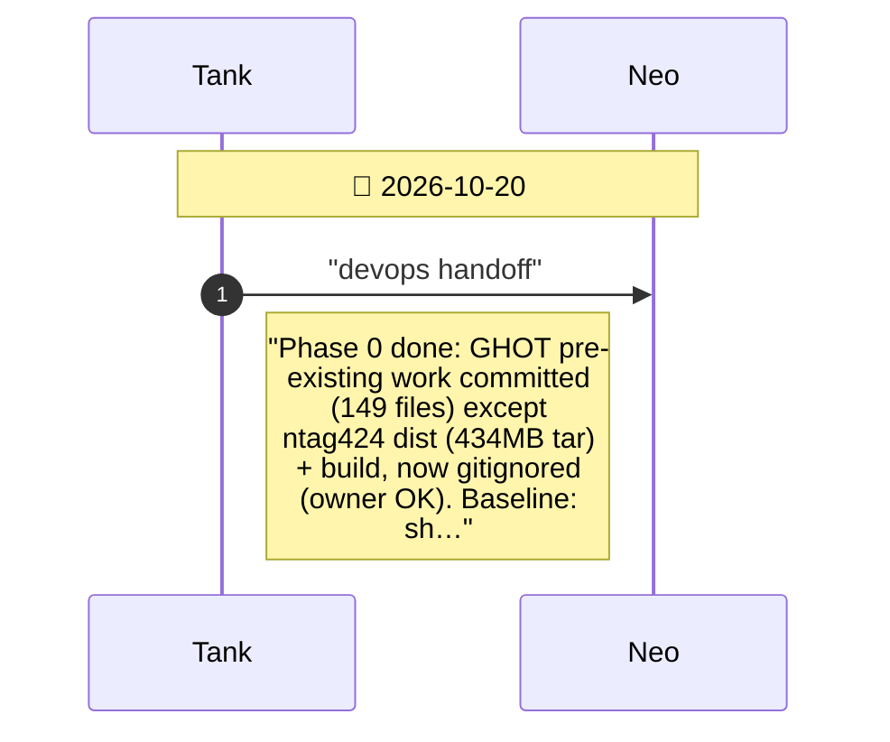
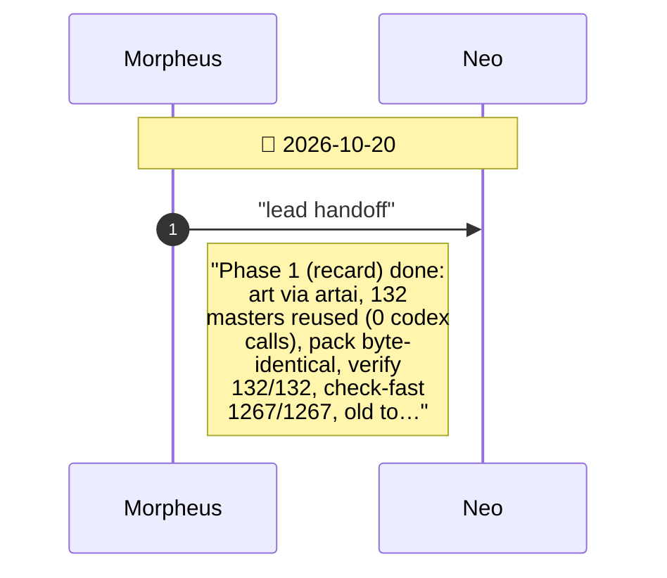
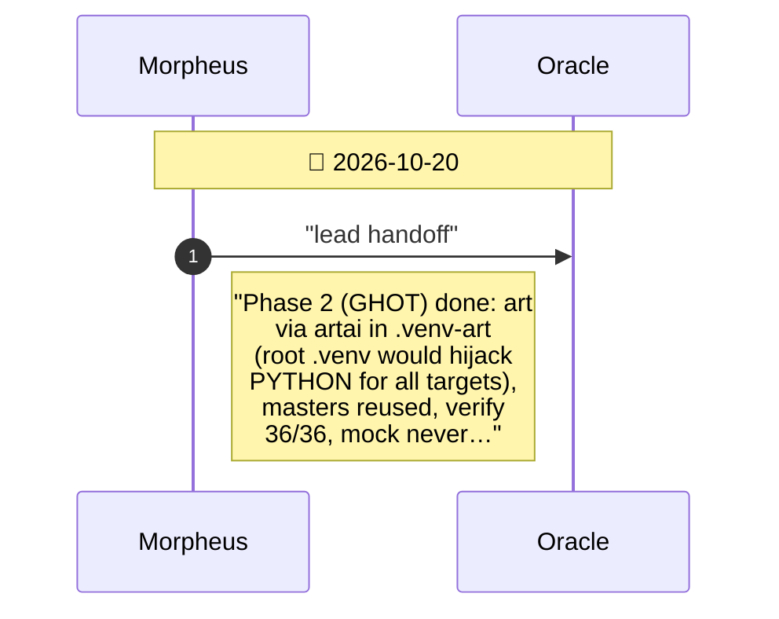
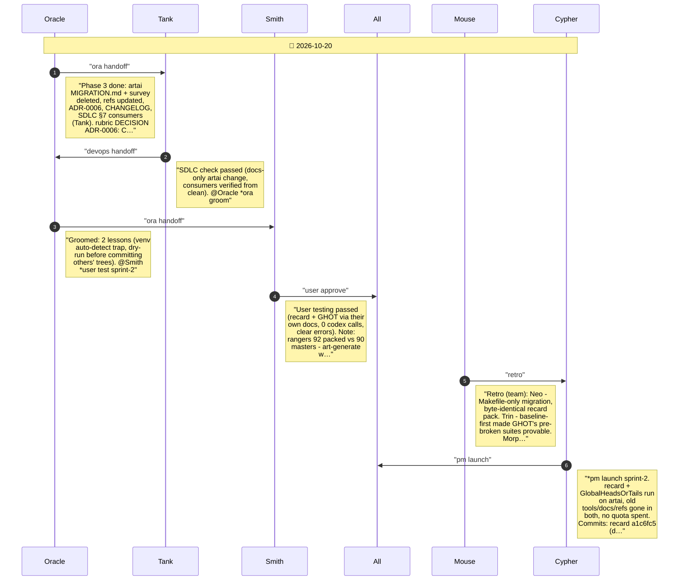

# CHAT_SPRINT_2 — Sprint Archive

## Summary

Sprint 2 moved recard and GlobalHeadsOrTails onto artai, pip-installed editable from ../artai (recard .venv, GHOT .venv-art to avoid hijacking its workspace PYTHON). Existing masters were reused (132 recard, 36+90+37 GHOT), so no quota was spent; recard re-pack was byte-identical. GHOT's pre-existing work was committed first (434 MB tar excluded and ignored). Every old tool, test, doc and reference was removed from both repos (grep-verified), and artai's migration guide/survey with them; ADR-0006 records the install route. Nothing pushed.

---

## Planning

---

## Phase 0

Phase 0: GHOT baseline + commit pre-existing work

---

## Phase 1

Phase 1: recard on artai

---

## Phase 2

Phase 2: GlobalHeadsOrTails on artai

---

## Phase 3

Phase 3: artai doc cleanup + ADR-0006

