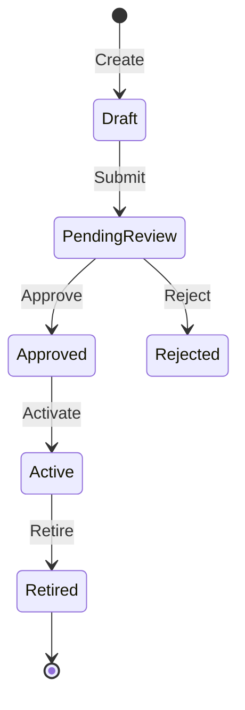

<!--
Domain Model & Ubiquitous Language specification template.
Owned by Cypher (Product Manager) and Morpheus (Tech Lead) — see .claude/skills/cypher/SKILL.md and .claude/skills/morpheus/SKILL.md.
Instantiated as `docs/DOMAIN.md` (or `docs/domain/<subdomain>.md` in multi-context projects).
Remove this note and the check block when creating a real artifact; checks belong to templates.
Reviewed by Smith and Morpheus using the DOMAIN rubric.
-->
# Domain Model: {Domain or Subdomain Name}

*   **Bounded Context**: `{ContextName, e.g. Billing, Catalog, Messaging}`
*   **Status**: {Draft | Active | Deprecated}
*   **Domain Owners**: Cypher (*pm), Morpheus (*lead)
*   **Last Updated**: {YYYY-MM-DD}

---

## 1. Executive Summary & Strategic Context

{Provide a 2-4 sentence summary of what business capabilities this domain handles. Explain its role in the overall system and its relationship to upstream/downstream contexts.}

* **In-Scope Capabilities:** {Core capabilities and responsibilities that strictly belong here}
* **Out-of-Scope:** {What explicitly belongs to other contexts, e.g. "User authentication is handled by IdentityContext"}
* **Upstream Contexts:** `{Contexts this domain depends on}`
* **Downstream Consumers:** `{Contexts or interfaces that consume this domain}`

---

## 2. Ubiquitous Language (Glossary)

Record terms used by domain experts and their meaning in this bounded context. Add code mappings only when implementation exists; technical terms may appear when they are the agreed domain language.

| Business Term | Kind (if useful) | Definition in this context | Code Mapping (optional) |
|---|---|---|---|
| **{Term}** | {Entity / Value Object / other, or omit} | {Meaning and relevant business rule} | `{symbol or N/A — not implemented}` |

*(Kinds: Entity, Value Object, Command, Domain Event, Domain Service, Policy)*

### Alternative or Deprecated Terms (optional)
Record terms likely to cause confusion; do not prohibit technical vocabulary without a domain reason.

| Forbidden / Deprecated Term | Preferred Ubiquitous Term | Rationale |
|---|---|---|
| `{e.g. UserRecord}` | `{User}` | {"Record" leaks database persistence detail into business logic.} |
| `{e.g. ProcessData()}` | `{ValidateAndApplyDiscount()}` | {Vague technical phrasing hides the specific business rule.} |

---

## 3. Context Map and Model (optional)

{Show neighboring contexts, ownership, and translation/integration relationships when they matter. Tactical model diagrams are optional.}

### Entities vs. Value Objects Summary
* **Entities (Identity-based):**
  * `{EntityName}`: Identity defined by `{ID property}`. Mutable lifecycle.
* **Value Objects (Attribute-based):**
  * `{ValueObjectName}`: Defined entirely by its attributes. Immutable; equality by value.

---

## 4. Aggregates & Business Invariants

Aggregates define transactional consistency boundaries. Changes within an aggregate must satisfy all invariants before the transaction commits.

### Aggregate Root: `{AggregateRootName}`

* **Root Entity:** `{RootEntity}`
* **Boundary Members:** `{Contained Entities, Value Objects}`
* **Business Invariants (Must ALWAYS Be True):**
  1. *Invariant 1:* {e.g. An Order must contain at least one OrderLine before transition to Placed.}
  2. *Invariant 2:* {e.g. Total order amount cannot be negative after discounts are applied.}
  3. *Invariant 3:* {e.g. Line items cannot be modified once status is Shipped.}

---

## 5. Lifecycle (optional)

{For concepts with meaningful states, document valid transitions and how invalid transitions are handled.}

### State Transition Matrix
| Current State | Triggering Command / Event | Next State | Guard Condition / Invariant |
|---|---|---|---|
| `{Draft}` | `{Submit}` | `{PendingReview}` | {All required fields valid} |
| `{PendingReview}` | `{Approve}` | `{Approved}` | {Authorized approver only} |
| `{PendingReview}` | `{Reject}` | `{Rejected}` | {Rejection reason provided} |

---

## 6. Domain Events (optional)

{Record significant business events and consumers when relevant; distinguish events from implementation side-effects.}

| Event Name | Trigger Condition | Key Payload Properties | Primary Consumers / Subscribers |
|---|---|---|---|
| `{EntityCreated}` | {When Entity.Create() succeeds} | `{entity_id, owner_id, timestamp}` | `{AuditService, NotificationService}` |
| `{StateChanged}` | {When state transition completes} | `{entity_id, old_state, new_state, actor}` | `{AnalyticsContext, DownstreamSync}` |

<!-- RUBRIC-START -->
## Check — DOMAIN

- [ ] **PASS** — `LANG` (Does the ubiquitous language define terms without technical jargon and map 1:1 to code?): Each included term has a context-specific definition; any kind or code mapping shown is accurate, and unimplemented concepts are labeled.
- [ ] **PASS** — `BOUND` (Are the boundaries and responsibilities of this domain clearly defined?): Explicitly documents what is in-scope vs. out-of-scope, and names upstream/downstream integrations.
- [ ] **PASS** — `INVAR` (Are aggregate roots and consistency boundaries defined with enforceable rules?): Identifies aggregate roots, their contained entities/value objects, and invariants that must always hold true across transactions.
- [ ] **PASS** — `STATE` (Does the model define valid lifecycle states and transitions for key entities?): For concepts with lifecycle states, defines valid transitions and triggers; otherwise marks the criterion N/A with a reason.
- [ ] **PASS** — `EVENT` (Are domain events and their payloads documented for business occurrences?): For relevant domain events, records triggers and consumers; otherwise marks the criterion N/A with a reason.
- [ ] **FAIL** — Any required PASS condition is unmet or unsupported; cite the missing evidence and smallest correction.
<!-- RUBRIC-END -->
