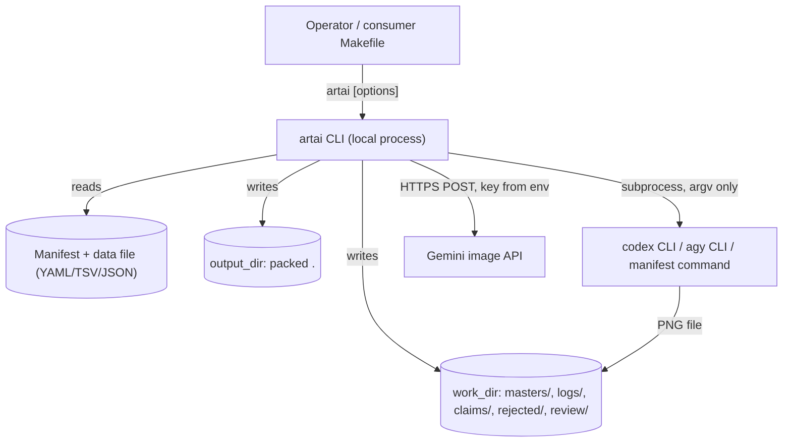
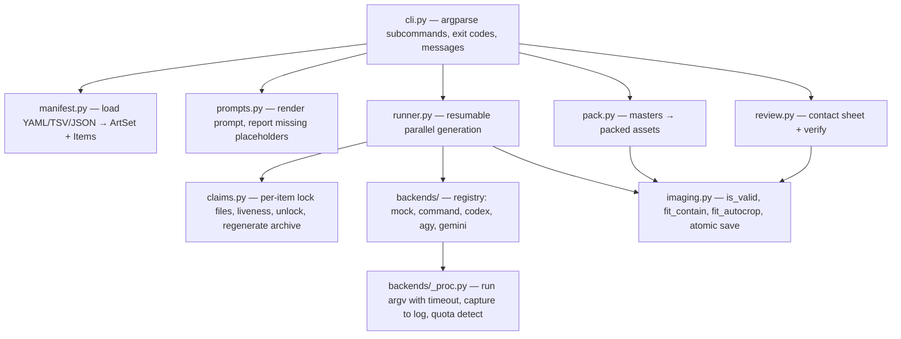

# Architecture Document: artai

*   **Status**: Approved at Smith Gate 2 (round 2, agents/smith/gate2_sprint1_review.md)
*   **Author**: Morpheus
*   **Last Updated**: 2026-10-20
*   **Scope**: Project-wide ARCH.md, written for Sprint 1 (`docs/sprints/USER_STORIES_SPRINT1.md`)

---

## 1. Executive Summary & System Overview

artai is a single Python CLI that turns a manifest of art items into reviewed, web-ready images.
It merges three predecessors (survey: `agents/oracle/art_tooling_survey.md`): it takes
GlobalHeadsOrTails' manifest/template/autocrop/review model, recard's run semantics
(resumable, quota-terminal, bounded parallelism, dimension-based validation, keep masters and
pack separately), and the deleted `sticker_art.mjs`/`nanobanana_backend.mjs` hardening
(per-item claims, timeouts, per-item logs, safe codex, Gemini API, verify, regenerate, unlock).
Everything project-specific stays in the consumer projects.

## 2. System Context & Boundaries



Trust boundaries: the manifest is trusted operator input but is never passed through a shell;
provider CLIs and the Gemini API are untrusted output producers — their files are accepted only
after Pillow opens them at ≥ `min_size`. Credentials come only from environment variables.

## 3. Component & Container Architecture



### Component Inventory
| Component | Responsibility | Inputs | Outputs |
|---|---|---|---|
| `cli.py` | Parse arguments, apply overrides, map errors to messages and exit codes (0 ok, 1 error/failure, 2 quota) | argv | stdout/stderr, exit code |
| `manifest.py` | Load and validate a manifest of any kind; resolve paths and defaults | file path, CLI overrides | `ArtSet`, `list[Item]` or `ManifestError` |
| `prompts.py` | Render each item's final prompt (GHOT `PromptEngine` semantics, ported verbatim for parity) | `ArtSet`, `Item` | `(prompt, missing_placeholders)` |
| `imaging.py` | All Pillow work: validate by dimensions, contain/autocrop fit, atomic save | image paths, fit params | image files, bool |
| `backends/` | One module per provider behind one contract; registry lookup by name; unknown name is an error | `Job` | master PNG at `job.master`, or `QuotaExhausted` / `GenerationFailed` |
| `claims.py` | Exclusive per-item claim files holding `{pid, start_time, host}`; liveness check; stale unlock; regenerate archive | work_dir, id | claim acquired/busy, archived files |
| `runner.py` | Schedule items over N workers; skip valid masters; retries; stop all on quota; summary | items, backend, options | `RunSummary` |
| `pack.py` | Convert every valid master to the packed format/size | work_dir, output_dir, fit | `PackSummary` |
| `review.py` | Self-contained HTML contact sheet; `verify` (exists, dimensions, duplicate sha256) | ArtSet, items | HTML path, `VerifyReport` |

### Data model

```python
@dataclass(frozen=True)
class ArtSet:
    name: str; description: str; kind: Literal["yaml", "list"]
    work_dir: Path; output_dir: Path; review_dir: Path
    theme: str; style: str; default_template: str
    fit: Literal["autocrop", "contain"]; resolution: tuple[int, int]   # autocrop canvas
    size: int                       # contain: longest edge
    pad: int; format: str; quality: int; min_size: int
    command: str                    # 'command' backend template ('' if none)

@dataclass(frozen=True)
class Item:
    id: str; prompt: str; prompt_template: str
    metadata: dict[str, Any]; output_filename: str; reference_image: Path | None
```

### Work directory layout
```
<work_dir>/masters/<id>.png      generated originals (resume source of truth)
<work_dir>/logs/<id>.log         backend output per item (appended per attempt)
<work_dir>/claims/<id>.lock      exclusive claim while an item is being generated
<work_dir>/.quota-exhausted      ISO timestamp; written on quota stop
<work_dir>/rejected/<UTC-ts>/    regenerate archive (master + packed)
<review_dir>/contact_sheet.html  default review_dir = <work_dir>/review
<output_dir>/<id>.<format>       packed assets (or item.output_filename)
```

## 4. Runtime Interaction & Critical Flows

### 4.1 `artai generate`
```mermaid
sequenceDiagram
    autonumber
    actor Op as Operator
    participant CLI as cli
    participant M as manifest
    participant R as runner
    participant C as claims
    participant B as backend
    participant I as imaging
    Op->>CLI: generate m.yaml --backend codex --parallel 4 --ids ...
    CLI->>M: load(m.yaml, overrides)
    M-->>CLI: ArtSet, Items (or ManifestError → exit 1, nothing written)
    CLI->>B: registry[name](set, env) — preflight (key present, yolo rules)
    CLI->>R: run(items, backend, opts)
    loop each item, ≤N worker threads, until quota_event set
        R->>I: is_valid(master, min_size)?
        alt valid
            R-->>R: skip
        else
            R->>C: try_claim(id)
            alt held by live process
                C-->>R: busy → result "busy"
            else acquired
                R->>I: is_valid(master)? (another runner may have just finished)
                loop attempt 1..retries
                    R->>B: generate(Job(id, prompt, master, log, timeout, reference))
                    B-->>R: ok / GenerationFailed / QuotaExhausted
                end
                R->>C: release(id) (finally)
            end
        end
    end
    R-->>CLI: RunSummary(ok, skip, busy, failed_ids, quota)
    CLI-->>Op: summary line; exit 0 / 1 / 2
```
Concurrency: worker threads (`ThreadPoolExecutor`) — the work is I/O-bound (subprocess/HTTP).
On `QuotaExhausted` the runner sets a `threading.Event`, writes the marker, and no new item
starts; items already in flight finish. Ctrl-C: in-flight subprocesses are terminated, claims
released in `finally`; nothing half-written remains because every write is atomic.

### 4.2 `pack` / `review` / `verify`
`pack` iterates `masters/*.png` that belong to the manifest (ids not in the manifest are
ignored), fits each, and writes `<output>.tmp` → `os.replace`. `review` renders HTML from the
manifest and the packed files. `verify` checks each selected item's packed file: opens, required
size (autocrop: exactly `resolution`; contain: longest edge == `size`), then sha256 duplicates.

### 4.3 `regenerate` / `unlock`
`regenerate` requires `--ids`; first checks **all** selected ids for live claims (refuse all if
any is live), then moves master and packed file into `rejected/<ts>/`, then runs `generate`
for those ids. `unlock --ids` removes claim files whose owner is not alive; refuses live ones.

## 5. Interface & Contract Specifications

### Commands
| Command | Purpose | Exit codes |
|---|---|---|
| `artai status <manifest>` | lines: `set`, `items`, `masters` (real), `placeholders` (mock), `packed`, `missing` (= items without a packed file) + up to 8 ids, `quota` marker time if present | 0; 1 bad manifest |
| `artai prompts <manifest> [--json]` | id + final prompt per item; warnings for unknown placeholders on stderr | 0; 1 |
| `artai generate <manifest> [--backend B] [--parallel N] [--retries N] [--timeout S] [--min-size PX] [--ids ...] [--reverse]` | create masters | 0 all ok/skip; 1 any failed; 2 quota |
| `artai pack <manifest> [--fit F] [--format F] [--quality Q] [--size PX]` | masters → packed | 0; 1 any skipped |
| `artai review <manifest>` | contact sheet HTML, prints path | 0; 1 |
| `artai verify <manifest> [--ids ...] [--allow-mock]` | completeness, size, duplicates, no placeholder art | 0; 1 |
| `artai regenerate <manifest> --ids ... [generate options]` | archive + regenerate | as generate; 1 refused |
| `artai unlock <manifest> --ids ...` | clear stale claims | 0; 1 refused |

Common options on every command: `--work DIR`, `--out DIR`, `--style TEXT`, `--fit autocrop|contain`.
`--backend` is **required** for `generate`/`regenerate` (no default; omitting it prints the
choices and exits 1) — a missing flag can neither spend quota nor write placeholder art.
Defaults: `--parallel 2` (1–8), `--retries 2`, `--timeout 600`, `--min-size 512`.

### Manifest (YAML) — superset of GlobalHeadsOrTails' schema
```yaml
artwork_set:
  name: twelve_clans            # default: file stem
  output_dir: build/stickers    # packed images (default build/artai/<name>/out)
  work_dir: build/art/clans     # NEW (default build/artai/<name>)
  review_dir: ...               # default <work_dir>/review
  theme: "..."; style: "..."; default_template: "{prompt}"
  fit: autocrop                 # NEW; else derived: autocrop: true→autocrop, false→contain
  resolution: [512, 512]; pad: 10; size: 512
  format: webp; quality: 92; min_size: 512
  cli_command: "mytool --out {output_path} {prompt}"   # alias: command; placeholders
                                                       # {prompt} {id} {output}/{output_path} {resolution}
items: [ {id, prompt?, prompt_template?, metadata?, output_filename?, reference_image?} ]
# OR
data_file: cards.json           # JSON list (or {"items"|"cards": [...]}); relative to manifest
item_template: { prompt_template: "..." }   # or a plain string
```
TSV (`.tsv`/`.txt`) and JSON-list (`.json`) manifests produce `kind="list"` sets: name = file
stem, `fit=contain`, `size=512`, `quality=88`, template `{prompt}` + `--style`.

### Backend contract (`backends/base.py`)
```python
@dataclass(frozen=True)
class Job:
    id: str; prompt: str; master: Path; log: Path; timeout: float
    reference_image: Path | None; resolution: tuple[int, int]

class Backend(Protocol):
    name: str
    def preflight(self, items: list[Item], selected_count: int) -> None: ...  # raise ConfigError
    def generate(self, job: Job) -> None: ...  # write job.master or raise GenerationFailed / QuotaExhausted
```
| Backend | Mechanism | Env overrides (for tests & installs) |
|---|---|---|
| `mock` | deterministic Pillow drawing from id hash (GHOT `MockBackend`), 1024×1024, saved with PNG text chunk `artai-placeholder=mock` | — |
| `command` | `shlex.split(template)`, placeholders substituted **per argv element**, `shell=False` | — |
| `codex` | `codex exec --sandbox workspace-write --skip-git-repo-check <prompt>`; prompt = shared preamble ("use your image generation tool… do not write code") + subject + reference clause + "Save it to <abs master path>" | `ARTAI_CODEX_CLI` |
| `agy` | `agy -p <prompt> --output-format json --print-timeout 10m --sandbox [--model M] [--dangerously-skip-permissions]`; if master absent after exit, claim newest `<id>.png`/`<id>_*.png` from scratch dir | `ARTAI_AGY_CLI`, `ARTAI_AGY_SCRATCH` (default `~/.gemini/antigravity-cli/scratch`), `ARTAI_AGY_MODEL`, `ARTAI_AGY_YOLO=1` |
| `gemini` | `urllib.request` POST to Interactions endpoint, header `x-goog-api-key`; response `output_image.data` base64 PNG; signature check; atomic write | `GEMINI_API_KEY` (required), `ARTAI_GEMINI_MODEL` (default `gemini-nano-banana-2.1`), `ARTAI_GEMINI_ENDPOINT` |

**Placeholder rule (Gate 2).** `imaging.is_placeholder(master)` reads the `artai-placeholder`
chunk. For any backend other than `mock`, a placeholder master counts as *missing*: the runner
regenerates it (the real image replaces it atomically). `status` reports `placeholders: N`.
`verify` fails every item whose master is a placeholder ("<id>: placeholder art (mock)") unless
`--allow-mock` is given; packed files are judged through their master.

Quota detection (shared): `/quota|usage limit|rate limit|429|too many requests|upgrade your (subscription|plan)/i`
on subprocess output, or HTTP 429.

## 6. Cross-Cutting Concepts & Resilience

### Failure Modes & Error Handling
| Failure Mode | Trigger / Condition | System Behavior | User / Client Impact | Blast Radius |
|---|---|---|---|---|
| Invalid manifest | dup/unsafe id, bad line, missing data file, bad YAML | `ManifestError` raised in `load` before any write | `artai: <file>: <problem>` on stderr, exit 1 | none |
| Bad option | `--parallel 9`, unknown `--ids`, unknown backend, `regenerate` w/o ids | validated in cli before run | one-line message, exit 1 | none |
| Missing credential / unsafe yolo | `GEMINI_API_KEY` unset; `ARTAI_AGY_YOLO=1` with ≠1 id | `preflight` raises before first item | message names the variable/rule, exit 1 | none |
| Quota exhausted | quota text, HTTP 429 | stop scheduling, write marker, finish in-flight | "quota exhausted — re-run after reset; finished images are skipped", exit 2 | remaining items untouched |
| Provider failure / hang | non-zero exit, no/invalid image, timeout | retry up to `retries`; subprocess killed at timeout | failed ids listed, exit 1 | that item only |
| Provider writes junk | tiny or unopenable PNG | treated as failure; file left only if valid | listed as failed | that item |
| Crash mid-run | kill -9 | claim file remains; masters are atomic | next run reports item "busy" only if owner alive; dead owner's claim is taken over automatically | that item |
| Concurrent runs | two generators | claims are `O_CREAT|O_EXCL` | each item generated once | none |
| Pack of bad master | unopenable master | skipped, listed | `packed X/Y`, exit 1 | that item |

Stale claims: a claim whose recorded `(pid, start_time)` no longer matches a live process on
this host is treated as stale and **taken over automatically by `generate`** (the explicit
`unlock` command remains for operators and claims from another host).

### Security & Privacy
* **Authentication:** none of artai's own. Providers use their CLIs' cached logins or `GEMINI_API_KEY`.
* **Sensitive data:** the API key is read from the environment, sent only in a header, never
  logged, echoed, or written. Logs contain provider stdout/stderr only.
* **Command execution:** no `shell=True` anywhere; prompts are single argv elements.
* **Sandboxing:** codex runs in `workspace-write`; agy permission bypass only for a single-item,
  explicitly opted-in run.

## 7. Technical Stack & SDLC / Build Impact

* **Languages & Runtime:** Python ≥ 3.11 (per `docs/SDLC.md`).
* **Core Libraries & Tools:** Pillow, PyYAML (already declared); stdlib `subprocess`,
  `concurrent.futures`, `urllib.request`, `argparse`, `hashlib`, `html`. Dev: pytest, ruff.
* **Build-Environment Check (CRITICAL):**
  * New language, package manager, runtime version or external tool? **No.** Provider CLIs
    (`codex`, `agy`) are optional runtime tools invoked only when selected; tests use stand-in
    executables written to a temp dir. No Tank Phase 0 required.
  * No new make targets required (`make run ARGS=...` drives the CLI).

## 8. Architectural Decisions (ADRs) & Technical Debt

### Decision Records (`docs/DECISIONS.md`)
* `ADR-0001`: Python single package, porting recard's Node runner (owner's choice).
* `ADR-0002`: Two-stage masters → pack (recard) instead of GHOT's single-step generate-and-crop.
* `ADR-0003`: Providers via stdlib only (subprocess, urllib) — no vendor SDKs.
* `ADR-0004`: Per-item exclusive claim files with process identity replace GHOT's production lanes.
* `ADR-0005`: Safe defaults — codex without bypass flags; `--backend mock` default; no shell.

### Acknowledged Technical Debt & Trade-offs
* GHOT's hardcoded `families/forms` data-file expansion is dropped (no current data file uses
  it — all four are flat lists). Re-add as a generic expansion only if a consumer needs it.
* `autocrop: false` in GHOT meant "stretch to resolution"; artai maps it to `contain` (never
  distorts). Listed in `docs/MIGRATION.md` as a behaviour difference.
* Liveness check relies on `/proc` (Linux); elsewhere falls back to `os.kill(pid, 0)`, which
  cannot detect PID reuse. Acceptable: both consumers run on Linux.
* Live provider calls are not exercised in CI (quota cost) — stand-ins only (Story OQ1).
